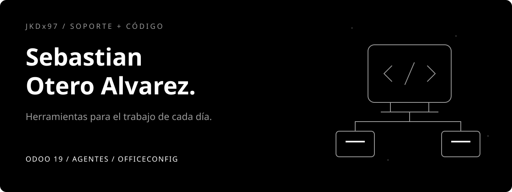

<a href="https://jkdx97-personal.paleant9.chatgpt.site/">Conoce mi mundo ↗</a> &nbsp; · &nbsp; <a href="https://github.com/JKDx97/OfficeConfig">Explora OfficeConfig ↗</a>

### 01 / Sobre mí

Soy **Sebastian Otero Alvarez**, también conocido como **JKDx97**. Me dedico al soporte técnico y la programación. Desarrollo herramientas para conectar la gestión de TI con el trabajo de cada día: Odoo 19, agentes de escritorio y aplicaciones para Windows.

### 02 / En lo que trabajo

<table>
<tr><td width="50%" valign="top">

#### Odoo 19
**La gestión de TI, conectada.**

Personalización de Odoo 19 para dar forma a procesos de soporte y gestión de equipos. Un punto de encuentro entre desarrollo y operación.

`Python` · `Odoo 19`

</td><td width="50%" valign="top">

#### Agentes de escritorio
**Del equipo al sistema.**

Agentes de inventario, monitoreo y chat de soporte. Herramientas que acercan los dispositivos y la atención técnica al ecosistema de Odoo.

`Go` · `Windows`

</td></tr>
<tr><td width="50%" valign="top">

#### OfficeConfig
**Configurar también es diseñar.**

Aplicación de escritorio para instalar, configurar, reparar y diagnosticar Microsoft Office con una interfaz desarrollada en WPF.

`C#` · `.NET` · `WPF`

[Ver el proyecto ↗](https://github.com/JKDx97/OfficeConfig)

</td><td width="50%" valign="top">

#### Una forma de construir
**Entender el problema. Crear la herramienta.**

El soporte técnico me acerca a los problemas cotidianos. La programación me permite convertirlos en herramientas que puedo seguir mejorando.

[Un poco más de mí ↗](https://jkdx97-personal.paleant9.chatgpt.site/)

</td></tr>
</table>

### 03 / Mi caja de herramientas

---

<h2 align="center">Del soporte al código. De la idea a la herramienta.</h2>

Fuera del código: gatos, motos y una partida.  <a href="https://jkdx97-personal.paleant9.chatgpt.site/">JKDx97 / Mi espacio personal ↗</a>

